<picture>
<source media="(prefers-color-scheme: dark)" srcset="docs/assets/header-dark.svg">

</picture>

I work on identity, endpoints and cloud security for the public sector in Scotland. The tools below started as chores I got tired of doing by hand: reconciling device and asset records, checking what a leaver touched, patching servers. Outside work the same habits go into Home Assistant, ESP32 boards and a few small apps.

| Project | What it does for you |
|---|---|
| [Jamf-Snipe-IT-Suite](https://github.com/CaputoDavide93/Jamf-Snipe-IT-Suite) | Keeps Jamf Pro, Snipe-IT, Azure AD and HiBob in step for starters, leavers and rehires. Every command that changes data has a dry run. |
| [AWS-Offboarding-Audit](https://github.com/CaputoDavide93/AWS-Offboarding-Audit) | Shows what a departing engineer did in every AWS account their SSO sign-in reaches, read-only, in one local HTML report. |
| [EC2-Linux-Security-Monitor](https://github.com/CaputoDavide93/EC2-Linux-Security-Monitor) | ClamAV scans, quarantine and patching for EC2 servers from two Bash scripts and systemd timers. No agent, no account. |
| [Mixergy-Home-Assistant](https://github.com/CaputoDavide93/Mixergy-Home-Assistant) | Puts a Mixergy hot water tank in Home Assistant: charge level, boost and Energy dashboard totals, installed through HACS. |
| [SunBridge-Growatt-Home-Assistant](https://github.com/CaputoDavide93/SunBridge-Growatt-Home-Assistant) | Reads Growatt solar data locally from a ShineLan-X datalogger, with no cloud account. |
| [MacOS-Game-Mode](https://github.com/CaputoDavide93/MacOS-Game-Mode) | Game Ready, a free Mac app that tells a cloud gamer whether lag comes from the Mac's Wi-Fi, the internet or the Mac. |

Also public: [Kallsup-Sendspin-Music-Assistant](https://github.com/CaputoDavide93/Kallsup-Sendspin-Music-Assistant) (an IKEA lamp turned into a Wi-Fi speaker), [HalfPast-Meter-Home-Assistant](https://github.com/CaputoDavide93/HalfPast-Meter-Home-Assistant) (UK smart meter data in the Energy dashboard) and [InkFrame-Immich](https://github.com/CaputoDavide93/InkFrame-Immich) (one photo a week on an e-paper frame). Everything else is in [the repository list](https://github.com/CaputoDavide93?tab=repositories).

<picture>
<source media="(prefers-color-scheme: dark)" srcset="docs/assets/stack-dark.svg">

</picture>

<picture>
<source media="(prefers-color-scheme: dark)" srcset="docs/assets/snake-dark.svg">

</picture>

